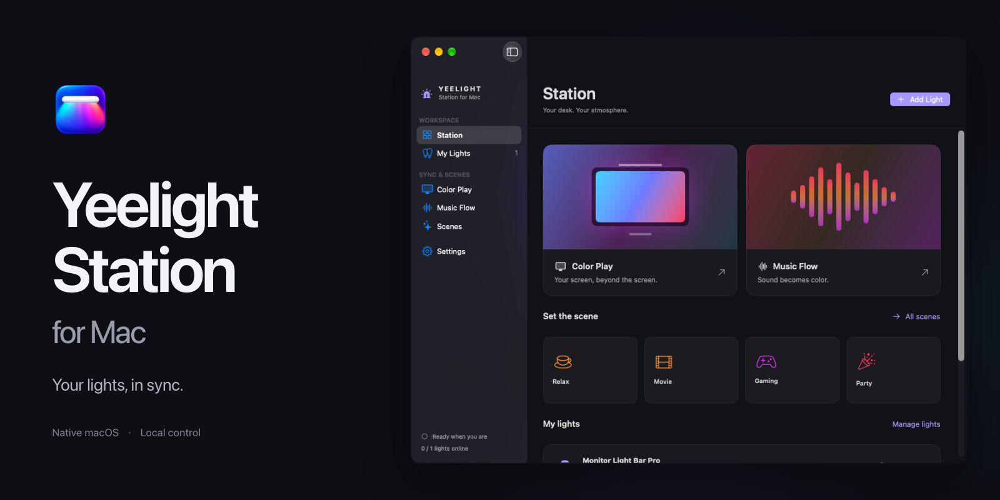
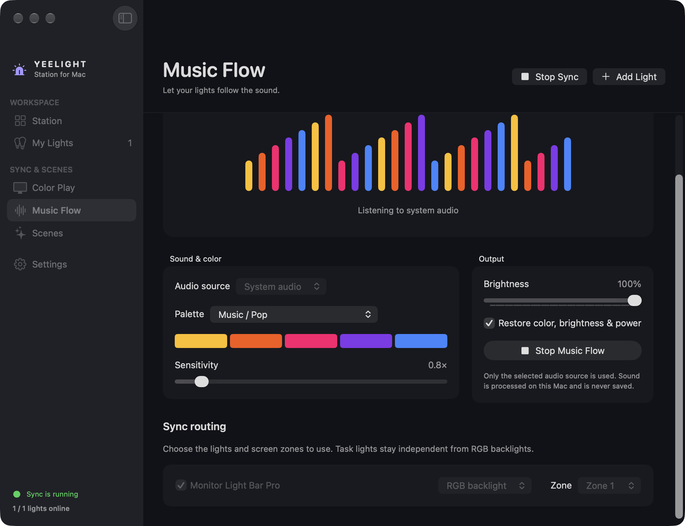

<p align="center">
  <a href="LICENSE"></a>
  <a href="https://github.com/DevAnuhas/yeelight-station-mac/releases/tag/v0.2.1"></a>
  <a href="#install"></a>
  <a href="https://github.com/DevAnuhas/yeelight-station-mac/releases/tag/v0.2.1"></a>
  <a href="docs/runbooks/distribution.md"></a>
</p>

# Yeelight Station for Mac

An independent native macOS implementation of Yeelight Station, reconstructed from the supplied Windows 1.5.0.31025 installer using [REA](https://github.com/morluto/rea) and Ghidra. Initial device target: **Yeelight Monitor Light Bar Pro (`lamp15`)**.

This is a working development port, not full Windows feature parity. See [implemented scope and verification](docs/implementation/status.md).

## Install

Requires **macOS 14 or later**. [Download the v0.2.1 macOS preview](https://github.com/DevAnuhas/yeelight-station-mac/releases/download/v0.2.1/Yeelight-Station-macOS.zip), unzip it, and drag **Yeelight Station.app** into **Applications**. Open the app from there.

The download supports Apple Silicon and Intel Macs and is Developer ID signed, notarized by Apple, and stapled for offline verification. You do not need Xcode to run it. [Release notes and checksums](https://github.com/DevAnuhas/yeelight-station-mac/releases/tag/v0.2.1) describe this preview's validation and limits.

Allow Station in **System Settings → Privacy & Security → Local Network** and permit its LAN traffic in any network filter.

Enable **LAN Control** in the Yeelight phone app, connect the Mac to the light's LAN, then choose **Add Light**. IP entry is available if multicast discovery is blocked. Color Play/system audio request macOS recording access on Start; microphone access is requested only for microphone input.

Closing the window leaves Station in the menu bar. Click or right-click its icon for separate task-light/backlight controls, brightness, saved scenes, and sync actions. **Quit** stops capture and releases sessions. The optional restore setting restores static color, brightness and power, not dynamic flows or proprietary effects.

<details>
<summary>See the real Music Flow interface</summary>



This is a captured native app window. The README cover also uses an actual Station dashboard capture; its source artwork and reproduction notes are in the [artwork guide](docs/runbooks/artwork.md).

</details>

## Build from source

Requires Xcode/Swift 6 tooling. No external Swift packages or Windows runtime are required.

```sh
scripts/build-app.sh
open "dist/Yeelight Station.app"
```

The script builds a universal Apple Silicon/Intel app and creates `dist/Yeelight-Station-macOS.zip`. Use `UNIVERSAL=0` to build only the current architecture. Development builds use ad-hoc signing. Follow the [signing, notarization and update workflow](docs/runbooks/distribution.md) to build an installed release with a persistent Developer ID identity.

For a disconnected visual preview:

```sh
open "dist/Yeelight Station.app" --args --demo
```

Preview mode is labeled and sends no device commands. Quit an existing instance before changing launch arguments.

## Develop and verify

```sh
swift test --build-system native
swift run --build-system native stationctl discover
swift run --build-system native stationctl probe 192.168.8.173 --model lamp15
```

`probe` is read-only. Run `dist/stationctl --help` for acknowledged power/color/brightness controls. Settings live in `~/Library/Application Support/YeelightStationMac/station.json`.

`StationCore` contains LAN protocols, persistence and recovered presets. `StationCapture` contains native screen/audio capture. `YeelightStation` contains the SwiftUI app. Tests include loopback device simulators and synthetic screen/audio fixtures.

## Reproduce reverse engineering

The original installer and extracted vendor binaries are deliberately not included. With a locally supplied installer and `7zz` (`brew install sevenzip`):

```sh
python3 scripts/research/extract-installer.py /path/to/YeelightStation_Setup_1.5.0.31025.exe --output .analysis-new
python3 scripts/research/import-presets.py .analysis-new/windows-app/Resources/Configs
```

Use [REA setup](docs/research/rea-tooling.md) to reproduce the pinned local toolchain and Ghidra decompiles. The [protocol report](docs/research/device-protocol.md) records hashes, RVAs, first-party references, inferred behavior and unresolved questions. [Architecture](docs/architecture/overview.md) explains the macOS replacements and remaining platform gaps.

## License

[MIT](LICENSE).
